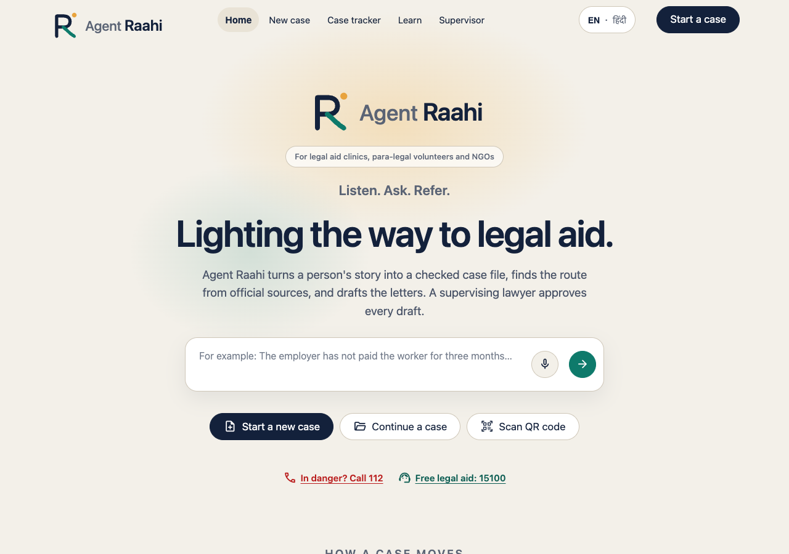
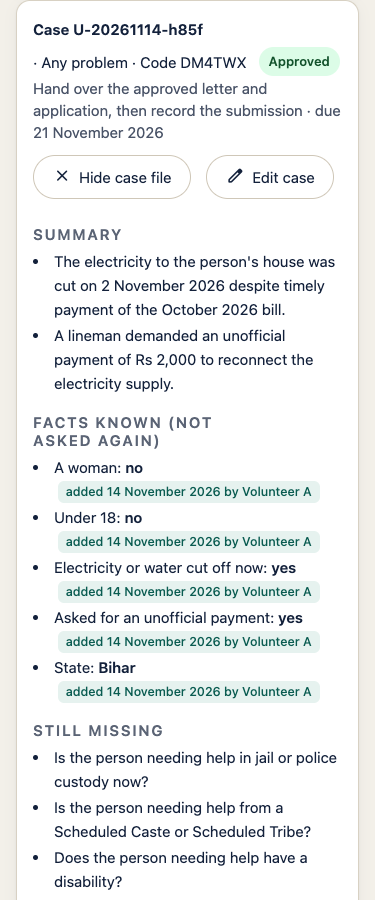

# Agent Raahi

**Lighting the way to legal aid** · *क़ानूनी मदद तक, रोशन राह*

An AI casework agent for legal aid clinics and NGOs. A volunteer types or speaks a person's story; Agent Raahi
turns it into a checked case file and drafts, and the supervisor (for example the clinic's supervising lawyer)
approves every draft before it is used. Built for Code for a Billion (Timely Justice track).

<p>
  
  
</p>

## The problem

- **5.64 crore cases are pending in Indian courts** (Rajya Sabha written reply citing National Judicial Data
  Grid data, July 2026; [report](https://telanganatoday.com/more-than-5-64-crore-cases-pending-across-indian-courts-rs)).
- **About 73% of the 5.11 lakh people in Indian prisons are undertrials**, and prisons are at **112.7% occupancy**
  (NCRB, Prison Statistics India 2024; [report](https://www.drishtiias.com/daily-updates/daily-news-analysis/prison-statistics-india-report-2024/print_manually)).
- **16,60,249 people received free legal aid in 2025–26** (Lok Sabha written reply, 13 March 2026;
  [report](https://www.newkerala.com/news/a/over-166-lakh-people-received-free-legal-aid-470.htm)).

Behind those numbers, legal aid clinics and para-legal volunteers turn people's stories into case files by hand.
Facts get lost between visits, the right papers are not asked for, and nothing records what was sent or who
checked it.

## Try the Practice Clinic

**Live app: <https://agent-raahi.streamlit.app>** · **Demo video (2 min): <https://youtu.be/bo7AEsoNzYQ>**

The app runs as the *Agent Raahi Practice Clinic*: every story and
case in it is fictional. Please never type a real person's details.

| Sign in as | Passcode or password |
| --- | --- |
| A volunteer (Case tracker, Start a case) | clinic passcode **`volunteerpassword`** |
| The supervisor (Supervisor page) | supervisor password **`supervisorpassword`** |

These are practice passwords only, used nowhere else.

**A 3-minute path**
1. **Start a case**, sign in with the clinic passcode and any volunteer name, for example "Volunteer X".
2. Paste one story from [docs/practice_run/stories.md](docs/practice_run/stories.md) into the story box and press
   **Read the story**. Answer the questions it asks (or press *Don't know*).
3. Press **Run research** (choose the state first), then **Draft the letter**, then **Make the drafts**, and
   **Send to supervisor**.
4. Open **Supervisor** and sign in with the supervisor password and a *different* name, for example "Supervisor"
   (the person who sent a case can never approve it). Open the case under "Waiting for you", tick the research
   points you agree with, and press **Approve drafts**.
5. Open **Case tracker** to see the case, its next step and its due date.

The evaluation of the AI on test cases is in [docs/EVALUATION_RESULTS.md](docs/EVALUATION_RESULTS.md), and the
practice run with five volunteers on 13 November 2026 in [docs/PRACTICE_RUN.md](docs/PRACTICE_RUN.md).

## What Agent Raahi does

1. **Tell the story:** typed or spoken, in Hindi, Hinglish or English. Phone, Aadhaar and email numbers are
   removed before any AI sees the text.
2. **Ask only what is missing:** the agent reads the story into facts the volunteer checks, then asks the missing
   questions one at a time ("Don't know" is always allowed).
3. **Free legal aid check:** rule-based, from the Legal Services Authorities Act and the state income limits.
4. **Research from official websites only:** for problems our verified files don't cover; every point has its
   source and is labelled "AI research, not yet checked by a lawyer".
5. **Drafts:** a complaint letter, a case summary and, when the person qualifies, a legal aid application.
6. **Readiness checklist:** documents and facts, each ticked, with a reason for anything still missing.
7. **The supervisor decides:** checks each research point (approve or reject), then approves the drafts or sends
   them back with a reason. The person who sent a case can never approve it.
8. **After approval:** a case slip with a code and QR code to continue the case later, the Case tracker with
   next steps and due dates, and the handoff record (submitted, acknowledged).

Plus, for undertrials, the **Section 479 BNSS date calculator**: the one-third and one-half dates worked out by
plain, tested code from the statute and the sentence table. It is an aid for the lawyer, never a release
decision: the jail superintendent must apply and the court decides.

## Safety by design

- **No predictions:** never the outcome of a case, bail chances, flight risk, risk of re-offending, guilt or
  credibility; nobody is scored or ranked.
- **Every draft starts "DRAFT — to be checked by a lawyer"** and ends with how it was prepared (the AI model
  used, rule-based dates, the supervisor's approval date). This follows the disclosure and verification duties in
  the Supreme Court's draft Regulations for Use of AI in Courts, 2026
  ([3 June 2026](https://www.scconline.com/blog/post/2026/06/05/sc-issues-draft-ai-regulations-for-courts/)),
  because drafts may later be filed in court.
- **No personal details stored:** no names, phone numbers, Aadhaar numbers or addresses; those blanks stay empty
  in every draft, for the person to fill in by hand.
- **Official sources only:** legal points come from our verified files (each with its Source line) or from
  official websites; anything else is dropped.
- **Supervisor approval:** nothing is used or added to the case file until the supervisor approves it; self-approval is blocked.
- **Audit record:** every step, by whom and when, for every case.
- **Works without AI:** dates and eligibility are plain code with tests; if the AI is busy, the form opens.

**What AI is used for:** reading the story into facts (which the volunteer checks), choosing the missing
questions, and summarising research from official websites. **AI never decides** eligibility, dates or
outcomes.

## Evidence so far

All of it on fictional cases; none of it is a real deployment.

- **Evaluation on 10 fictional test cases** (scored by hand against an answer key):
  [docs/EVALUATION_RESULTS.md](docs/EVALUATION_RESULTS.md).
- **Practice run, 13 November 2026:** five law-school volunteers and one supervisor used the live Practice Clinic
  with fictional stories: [docs/PRACTICE_RUN.md](docs/PRACTICE_RUN.md). In a practice run with five law-school
  volunteers using fictional cases, all five said they would recommend it to their clinic (5 out of 5) and rated
  "it would save me time" 4.8 out of 5; trust in the drafts was lower (3.4), as expected for a tool whose drafts
  a lawyer must check ([details](docs/PRACTICE_RUN.md#what-volunteers-told-us)).
- **Automated tests:** 988 tests pass (`pytest`, 14 November 2026; 21 more are skipped because they need live services), including every rule above.

## How it was built

Built entirely by a team of non-programmers using Claude Code inside AgentFoundry (Developer mode), prompt by prompt, with every change tested and reviewed. 988 automated tests pass.
Python and Streamlit, deployed on Streamlit Community Cloud; Supabase (Mumbai) for the
clinic's records; Google Gemini for reading stories, with Groq as the backup; Tavily as the backup search for
official websites; Sarvam AI for speech to text.

## Privacy, limits and what's next

Privacy: [docs/PRIVACY.md](docs/PRIVACY.md) (what is stored, what is sent to which service, who approves).
More detail on the content files, safeguards, languages and the lawyer's checklist:
[docs/CONTENT.md](docs/CONTENT.md).

Limits and next steps:
- **Lawyer review** of every knowledge file before real use.
- **A partner pilot** with a legal aid clinic, with consent, before any real case.
- **Works on free AI tiers.** A clinic can start on Gemini's free tier with no code changes. The live demo uses the
  paid tier, capped at ₹500 a month, because the free daily limit ran out during the practice run.
- **More languages** via Bhashini (built, waiting for access); English and Hindi today.
- **The online-fraud guide:** written, not yet in the app (Coming soon).

## Run it yourself

```bash
git clone https://github.com/aspirantarushi/agent-raahi.git
cd agent-raahi
pip install -r requirements.txt
cp .streamlit/secrets.toml.example .streamlit/secrets.toml   # then fill in your own keys and passwords
streamlit run app.py
```

Step-by-step setup for the cloud: [docs/GO_ONLINE.md](docs/GO_ONLINE.md). Tests: `pytest`.

## Licence and credits

MIT licence ([LICENSE](LICENSE)). Built for Code for a Billion by a team of non-programmers, with Claude Code. Legal content is
drawn from official sources listed in [docs/CONTENT.md](docs/CONTENT.md).

Demo video: https://youtu.be/bo7AEsoNzYQ
